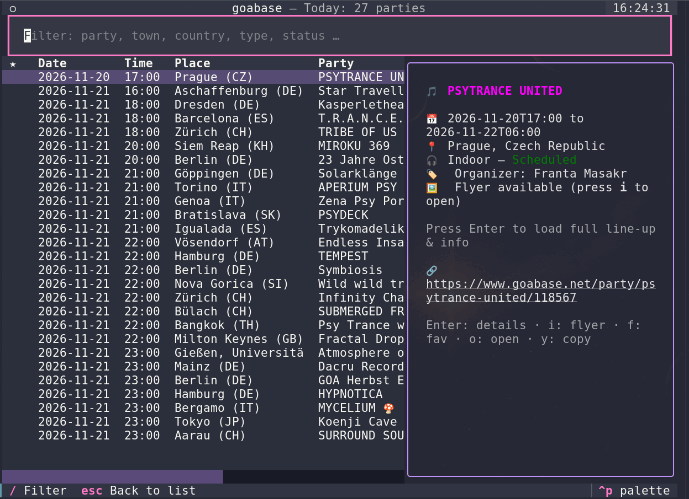

# 🌀 goabase-tui

A fast, lightweight terminal user interface (TUI) for browsing ongoing and upcoming Goa & Psytrance parties from the [Goabase](https://goabase.net) API — built with [Textual](https://textualize.io) and styled with the **Dracula** theme.

<p align="center">
  
</p>

### 🎛️ Line-up & Event Details View (`Enter`)


---

## ✨ Features

* 🗓️ **Today, Upcoming & All Views:** Cycle through ongoing/today's parties, upcoming events, or the full event list.
* 🎛️ **Full Line-up & Event Info:** Press `Enter` on any event to fetch the full line-up, music styles, location details, and organizer notes directly from the Goabase API.
* 🖼️ **Flyer Preview:** Open high-resolution party flyers directly in your browser with a single keypress (`i`).
* ★ **Persistent Favorites:** Bookmark events locally (`~/.goabase_tui_favorites.json`) and toggle a favorites-only view anytime.
* 🔍 **Live Filtering:** Search in real time by party name, town, country (e.g., `CH`, `DE`, `AT`), event type, or status.
* 🔗 **Quick Actions:** Open event pages in your browser or copy the URL to your clipboard.
* 🧛 **Dracula Theme:** Ships with Dracula enabled by default (switchable anytime via `Ctrl+P` ➡️ *Change theme*).

---

## ⌨️ Keybindings

| Key | Action |
| :--- | :--- |
| `Enter` | Load full **line-up, location & info** for selected party |
| `i` | Open high-resolution **flyer image** in browser |
| `t` | Cycle view: **Today** ➡️ **Upcoming** ➡️ **All** |
| `f` | Toggle **favorite (★)** for selected party |
| `m` | Toggle **favorites-only** view |
| `/` | Focus the live search/filter bar |
| `Esc` | Return focus to the party table |
| `o` | Open selected party link in browser |
| `y` | Copy selected party link to clipboard |
| `r` | Reload party data from the Goabase API |
| `q` | Quit the application |

---

## 🚀 Installation & Usage

Install globally with [`pipx`](https://pypa.io) (requires Python 3.10+):

```bash
pipx install goabase-tui
```

Run from anywhere in your terminal:

```bash
goabase-tui
```

To update later:

```bash
pipx upgrade goabase-tui
```

---

## 🤝 Contributing

Contributions, ideas, and bug reports are welcome! Feel free to open an issue or submit a pull request on the [issues page](../../issues).

## 📝 License

This project is [GNU GPLv3](LICENSE) licensed.

---

<p align="center">Made with 💜 for the Psytrance Community.</p>
